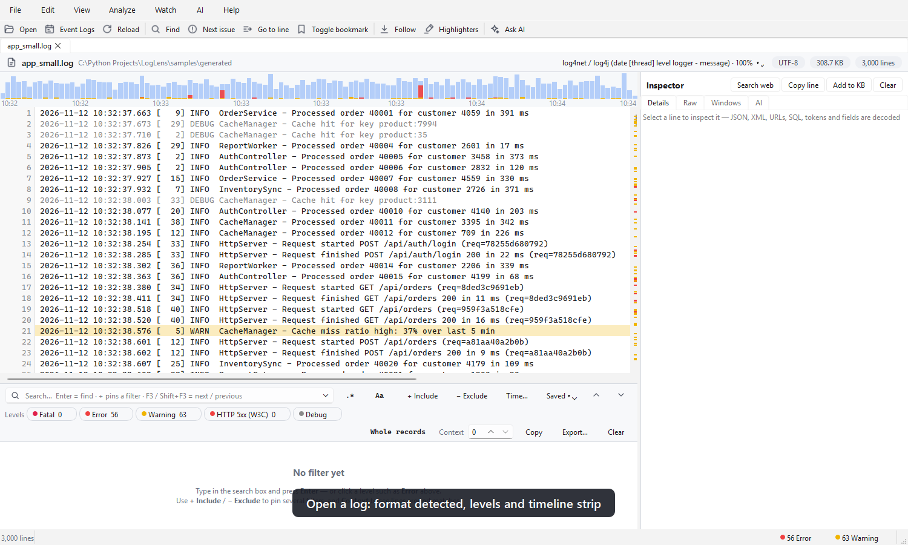
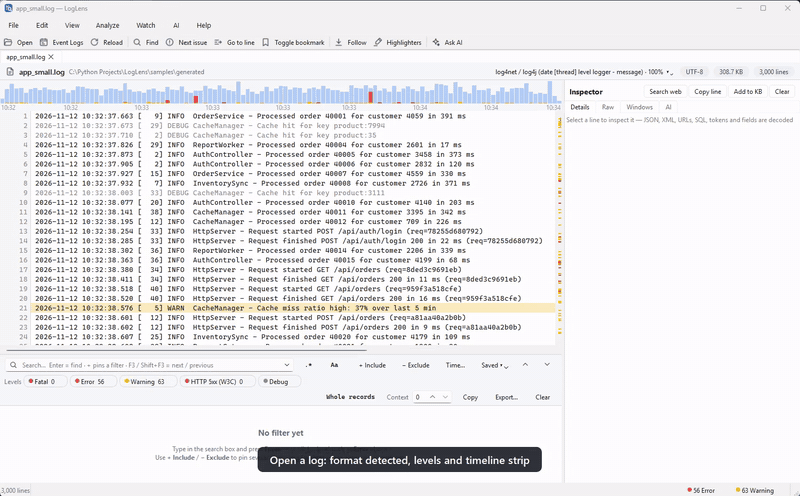
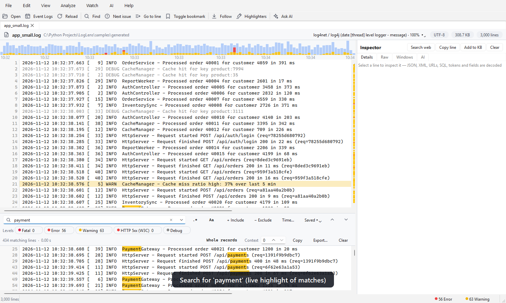
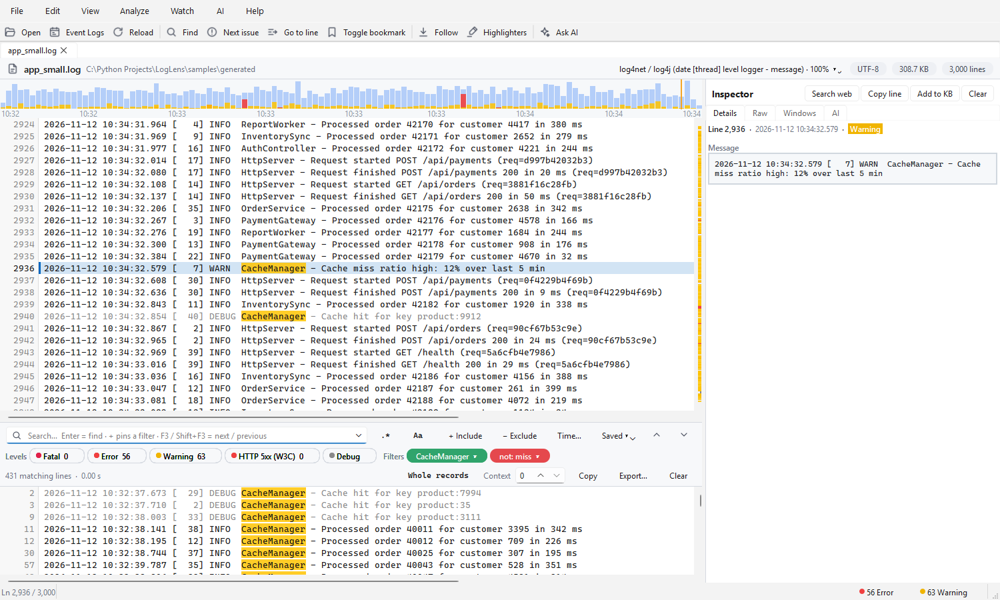
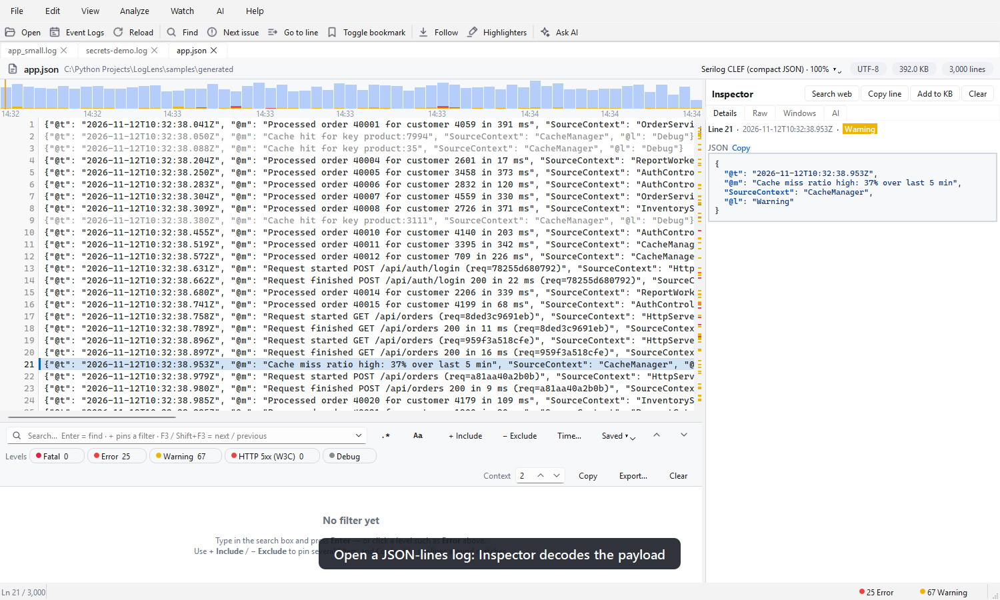
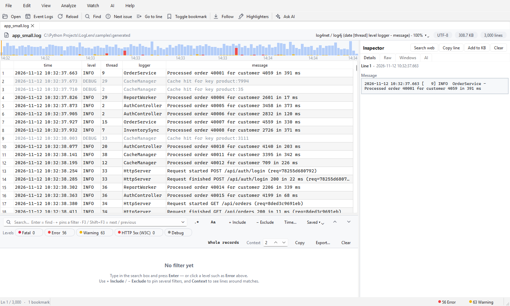
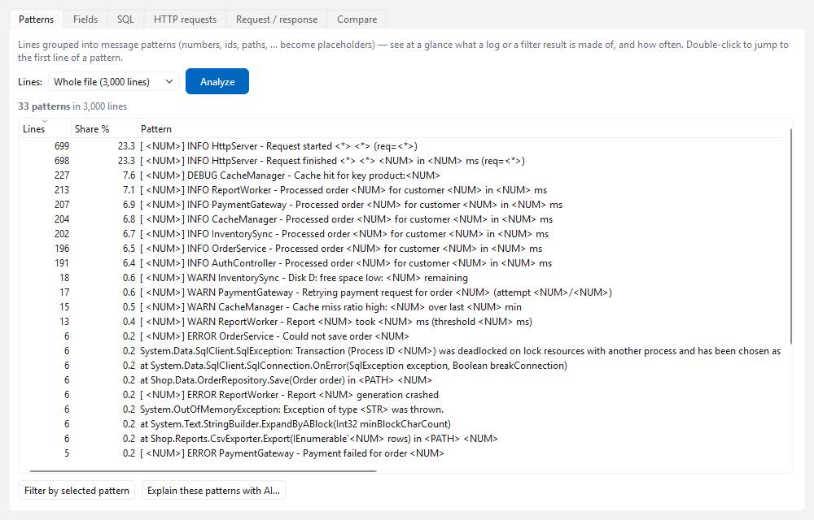
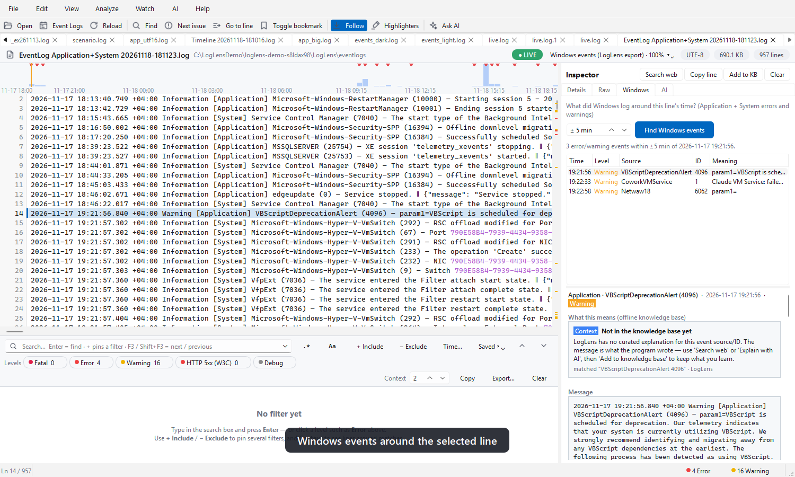
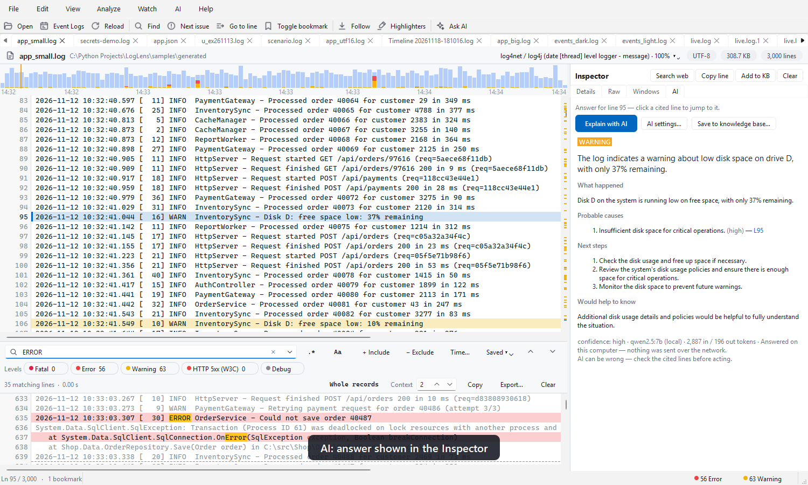
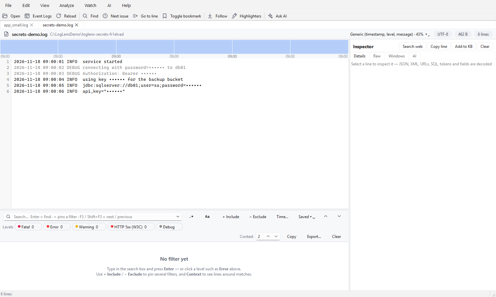

<div align="center">



# LogLens

**Read any log. Understand it fast. Keep it private.**

A fast log viewer and analyzer for Windows: huge files, live tail, powerful filters, Windows Event Log correlation,
an offline knowledge base that explains errors, and an optional AI assistant that can run **entirely on your own computer**.

[](https://github.com/ericharutyunyan1996/LogLens/releases/latest)
[](LICENSE)


[**Download the installer**](https://github.com/ericharutyunyan1996/LogLens/releases/latest) ·
[**Watch the 7-minute tour**](https://github.com/ericharutyunyan1996/LogLens/releases/download/demo/LogLens-demo-voice.mp4)

<br>



</div>

---

## Why LogLens?

You open a 3 GB log, search for one request, and your editor freezes. Or you stare at a Windows Event ID and have no idea
what it means. LogLens is built for exactly that moment: it opens big files instantly, finds the needle, and tells you
what the haystack means, without sending your data anywhere unless you choose to.

## Highlights

| | |
|---|---|
|  | **Search and filter, instantly.** Live highlight, next/previous match, level filters, time ranges, bookmarks, and context lines around every hit. |
|  | **Combine filters as chips.** Pin "must contain" and "must not contain" terms and stack as many as you need. |
|  | **Inspector that decodes for you.** JSON, XML, JWT, URLs, SQL, base64, headers and stack traces, right next to the line. |
|  | **Columns view.** Any log becomes a sortable table of parsed fields (25+ formats detected automatically, or define your own). |
|  | **Understand a whole log.** Message patterns, field value counts, SQL over parsed records, compare two logs, request/response pairs, HTTP statistics. |
|  | **Windows Event Log correlation.** Read channels or `.evtx` files, follow events live, and see what Windows logged around any line. |
| | **Other servers and containers.** `File → Servers…` adds Windows servers whose Event Viewer logs are read remotely, in parallel, on one timeline (this Windows account or credentials kept in Credential Manager; nothing is installed on the server). `File → Containers & Kubernetes…` opens live logs of Docker containers and Kubernetes pods through your own `docker` and `kubectl`. |
|  | **Optional AI, private by design.** Claude, or a **local model through Ollama** where nothing leaves your computer. You see and edit a redacted preview before anything is sent. |
|  | **Mask secrets** with one click, so you can share your screen or screenshots safely. |

## Install

1. Download `LogLens-<version>.msi` from the [latest release](https://github.com/ericharutyunyan1996/LogLens/releases/latest).
2. Double-click it, pick an install folder (or keep the default), and finish.
3. Open any `.log`, `.txt` or `.evtx`: right-click, **Open with LogLens**, or drag it onto the window.

Silent install for IT: `msiexec /i LogLens-<version>.msi /qn`. Newer versions upgrade older ones in place.

> The installer is signed with a self-signed test certificate for now, so Windows may say "Unknown publisher".
> Compare the SHA-256 on the release page if you want to verify it.

## Privacy

- Everything runs locally. No telemetry, no account.
- API keys live in the Windows Credential Manager, never in settings files.
- AI is **off until you turn it on**, always shows a redacted preview first, and works with a local model
  (Ollama, LM Studio, llama.cpp) so your logs never leave the machine.

## Everything it does
- **Read any log fast**: multi-GB files, live tail with rotation, auto encoding, ANSI colours, multi-line records
  (stack traces kept together), payloads decoded in the Inspector (JSON, XML, JWT, URLs, SQL, headers, base64, stack
  traces), character or line selection.
- **Find things**: filter chains (must / any / exclude + levels + time range), context lines, whole records, saved
  filters and shareable packs, find in all open logs, go to line / time, timeline strip (click to jump, drag to
  filter), bookmarks, issue navigation.
- **Understand**: offline knowledge base for Windows events, error codes and common messages (built-in + your own
  entries, packs, "not explained yet" queue), event facts, **Diagnose this computer** (crashes, restarts, failing
  services, installers, lockouts, brute force, app pools, storage, what changed, coverage gaps, WER reports), Windows
  events around any line, secrets detection and masking, web search with a cleaned query.
- **Analyze**: automatic format detection (25 formats + your own layouts / regexes), columns view, field value
  counts, SQL over parsed records, message patterns, compare logs or before/after, HTTP request statistics,
  request/response pairs, merged timelines of several logs + Windows events, folder / zip bundles.
- **Watch**: follow the newest file of a folder, alerts (matches, bursts, new kinds of message), Windows services,
  tray notifications, live dashboard, Windows event channels followed live.
- **AI (optional, opt-in)**: Claude via API key, environment, Bedrock, Vertex or Foundry — or a **local model**
  (Ollama, LM Studio, llama.cpp) where nothing leaves the computer; redacted, editable preview before anything is
  sent; live progress and Cancel; explain lines, records or the top patterns; save answers to your knowledge base.
- **Share**: export lines as text / CSV / JSON Lines, incident reports (Markdown / HTML, redacted).

<details>
<summary><b>For developers: run from source, build the installer</b></summary>

### Run (from source)
```
python -m venv .venv
.venv\Scripts\python.exe -m pip install -e .[dev,ai]
.venv\Scripts\python.exe -m loglens [file.log | folder | bundle.zip | events.evtx ...]
```

### Build the Windows app
```
.venv\Scripts\python.exe -m pip install -e .[build]
.venv\Scripts\python.exe tools\build.py
```
Intermediate outputs go to `dist\` (portable folder + zip, unsigned MSI); what you publish is `dist\release\`:
the **signed** `LogLens-<version>.msi` plus the README. The MSI (WiX 5 via a local dotnet tool; needs the .NET SDK)
shows an install-folder dialog, installs per machine, upgrades older versions in place (fixed UpgradeCode, version from
`loglens.__version__`, must be `x.y.z`) and remembers a custom folder. `tools\build.py --msi-only` rebuilds just the MSI.

#### Local signing (testing only)
```
powershell -ExecutionPolicy Bypass -File tools\signing.ps1 -Setup            :: create self-signed cert
powershell -ExecutionPolicy Bypass -File tools\signing.ps1 -Setup -Trust     :: elevated: trust it on this PC
```
`build.py` then signs automatically (`--require-signature` / `--no-sign`). Public releases use a real certificate via the
GitHub secrets described in `.github\workflows\release.yml`; pushing a `vX.Y.Z` tag publishes only the signed MSI + docs.

#### Installed layout
```
C:\Program Files\LogLens\    bin\ (LogLens.exe + _internal\ runtime)     read-only, admin-owned
%APPDATA%\LogLens\           settings.json, knowledge.db, SQL library            per user
%LOCALAPPDATA%\LogLens\      logs\loglens.log, eventlogs\                       per user, machine-local
```

### Layout
```
loglens/core       pure logic: index, search, records, payloads, formats, patterns, http, kb, diagnose, winevent
loglens/services   Qt services without widgets (LogDocument, jobs, knowledge, watch, diagnosis)
loglens/ui         widgets and dialogs
packaging/         PyInstaller spec, launcher, WiX (MSI) source, Inno Setup script
tests/             mirrors the package
tools/             developer tools (not shipped)
```

</details>

## License
MIT - free for everyone to use, change and share. See [LICENSE](LICENSE).
